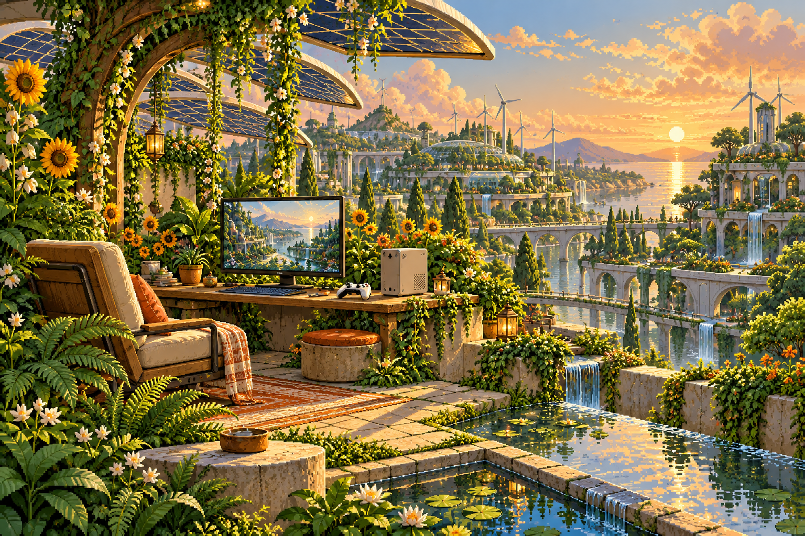

# GameWrap

**Windows games. Double-clickable Mac apps.**

[Get started](#build-and-install) · [Compatibility](#compatibility) · [Contribute](CONTRIBUTING.md)



A native Mac utility that wraps a Windows game folder, EXE, ZIP, RAR, or 7Z into a self-contained app, with an optional disk image. Choose your game, check the engine, and build. Your files and saves stay on your Mac; no account is required.

Apple silicon · macOS 14+ · MIT license · Early preview

## Requirements

- Apple silicon Mac running macOS 14 or later
- Rosetta 2 for running Windows games
- Xcode or the Swift toolchain to build GameWrap from source
- Internet access for the first runtime download (240 MB for Standard; 491 MB for Unity 6 / DXMT)
- Free disk space for the unpacked game, bundled runtime, and optional disk image

## Build and install

From a checkout of this repository:

```sh
scripts/package-app.sh
open ~/Applications/GameWrap.app
```

This builds a release app, signs it ad hoc, and installs it in `~/Applications`. To choose another location:

```sh
scripts/package-app.sh /tmp/gamewrap-preview
```

GameWrap is not notarized. For an app you built yourself, macOS may require using **Open** from Finder's context menu. Avoid removing quarantine attributes from software you do not trust.

## Wrap a game

1. Drop a game onto GameWrap, or choose it with the file picker. Put loose executables and their supporting files in a dedicated game folder first.
2. Check the detected Windows program and app name. Choose a custom icon if you want.
3. Choose **Standard** for games that already work, or **Unity 6 / DXMT (experimental)** for games such as OFFRECORD. Choose **Mac app** or **Mac app + DMG**, select a destination, and build. The runtime downloads automatically if needed.
4. Launch the completed app. First launch prepares a separate Windows environment and can take a minute or more.

Your original game files stay untouched. Each generated app includes its own runtime. Rosetta 2 is still required on the destination Mac.

## Troubleshooting

- **No Windows program found:** choose the folder containing the actual game, rather than a shortcut or installer download page.
- **Archive cannot be unpacked:** encrypted archives are not supported. Extract it yourself and choose the resulting folder.
- **Game does not start:** try another detected executable or the game's documented launch arguments under Advanced settings. Check its `last-run.log`.
- **Build fails:** copy diagnostics from GameWrap. Review them for private information before opening an issue.
- **First launch is slow:** wait for setup to finish before launching again.

Saves, Windows settings, and `last-run.log` live in `~/Library/Application Support/<Game name>/`. The DXMT engine uses `~/Library/Application Support/<Game name>/DXMT/` instead, so switching engines does not migrate or overwrite existing saves. The runtime cache lives in `~/Library/Application Support/GameWrap/runtimes/`. Removing a generated app does not delete its saves. Games with the same app name share that support folder, so use distinct names for separate installations.

## Compatibility

GameWrap is an early preview. A successful build does not guarantee a playable game. Anti-cheat, DRM, launchers, and unsupported Windows features can prevent games from working.

| Game | Engine | Observed result |
| --- | --- | --- |
| Hyperballin | Standard | Menu renders; a save file was created |
| OFFRECORD | Unity 6 / DXMT | Menu and opening scene render |

These are startup checks, not full-game compatibility certifications. See [verification details](docs/TESTING.md).

Choose **Unity 6 / DXMT (experimental)** under Compatibility engine before building. GameWrap downloads and verifies a pinned Wine 11.8 + DXMT 0.80 runtime and its dependencies, then bundles them into your Mac app. This combination reached OFFRECORD’s menu and opening scene. It supports Direct3D 10/11; keep Standard for games that require D3DMetal, including Direct3D 12 games. See [tested configuration](docs/compatibility/OFFRECORD.md). Saves are isolated by engine and are not automatically migrated.

## Network and accounts

GameWrap requires no GitHub account or sign-in. Its application network requests download the selected runtime from public GitHub releases (and normal download redirects). Standard downloads from Gcenx; Unity 6 / DXMT downloads from zzzz465/homebrew-wine-dxmt, 3Shain/dxmt, and Gcenx/macOS_Wine_builds. It contains no analytics or telemetry and does not upload your games or diagnostics. GitHub receives ordinary download-request metadata. Once cached, the runtime can be reused offline. Games themselves may have their own network behavior.

GitHub Actions checks run when repository code changes, independently of people running GameWrap. Failure emails go to repository subscribers according to their GitHub notification settings.

## Development and contributions

```sh
swift test --scratch-path "${TMPDIR:-/tmp/}gamewrap-build"
scripts/integration-test.sh  # opt-in: real runtime, signing, and DMG mounting
```

Keep build products outside iCloud-synced folders. See [CONTRIBUTING.md](CONTRIBUTING.md) for the development workflow and compatibility reporting, and [docs/TESTING.md](docs/TESTING.md) for recorded acceptance results.

## License and credits

GameWrap's source is [MIT-licensed](LICENSE). The public project contains no game, Wine, or Apple runtime binaries. The Standard runtime is downloaded separately from [Gcenx's build](https://github.com/Gcenx/game-porting-toolkit) and pinned to Game Porting Toolkit 3.0-3 with a SHA-256 check. The optional DXMT runtime also verifies every pinned component archive.

Wine, D3DMetal, and games have separate licenses. Generated game bundles are intended for personal use; do not publish them. See [third-party notices](THIRD_PARTY_NOTICES.md).

The native interface follows the [macOS design skill](https://github.com/ceorkm/macos-design-skill). The solarpunk illustration was generated with OpenAI image generation; see [artwork details and prompt](assets/ARTWORK.md). Native pixel accents draw visual inspiration from [Bitlight](https://github.com/berkboz/bitlight).
